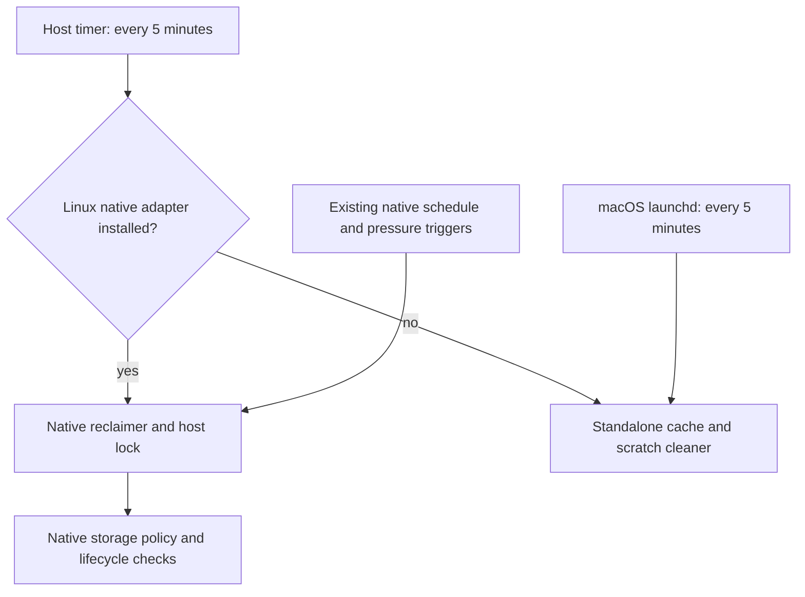

# Disk cleanup

Home Manager installs a five-minute user timer on Linux and a five-minute
launchd agent on macOS. A scheduler never starts a second instance of its
running cleanup service.

## Repository-owned storage

On a managed Linux host, install an executable adapter at
`~/.config/disk-cleanup/reclaim` (or under `XDG_CONFIG_HOME`). The adapter
changes into the machine's canonical checkout and executes its native
reclamation command. Keep real repository names and paths in this untracked,
machine-local adapter. Controller hosts must select their native
controller-safe mode.

The host cleaner replaces itself with that adapter before inspecting or
deleting any storage. The native owner retains its own pressure thresholds,
retention policy, install leases, worktree custody, and host lock. Existing
native scheduled or pressure-triggered passes enter the same owner and lock.
A failing adapter propagates its exit status; it never falls back to a second
cleanup implementation.

## Standalone hosts

Without a Linux native adapter, the standalone cleaner reclaims caches idle
for one day and generated scratch idle for one hour. It checks process
arguments and working directories, preserves dirty or unpushed worktrees and
local environment files, and leaves Herdr worktree retirement to its owner.
macOS refreshes its `lsof` working-directory inventory before every candidate
and keeps a candidate when that inventory is unavailable.

Session databases, transcripts, and shell-history backups are never deleted
based on age. Docker cleanup uses Docker's own unused-state pruning; it never
removes volumes or runtime containerd/CRI objects.

One-off host recovery belongs outside this recurring service. Changing a
host's native policy belongs in its owning repository rather than in the
adapter or this standalone cleaner.
